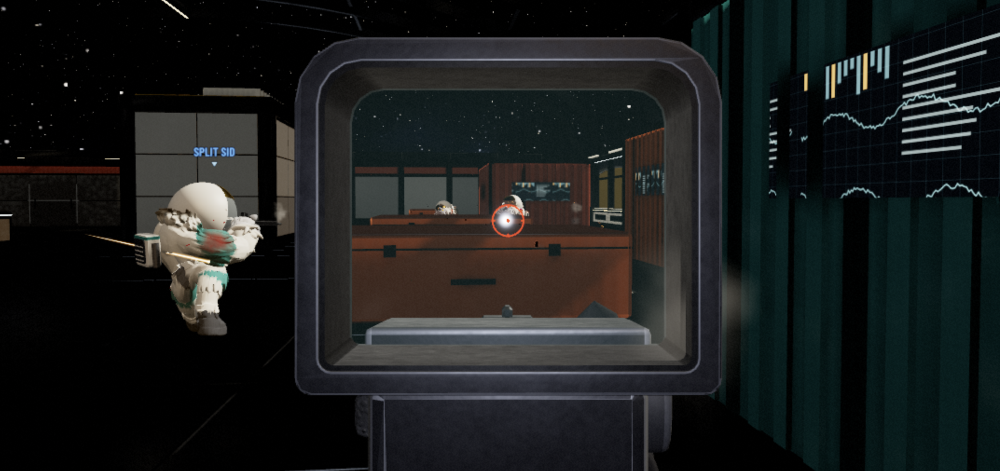
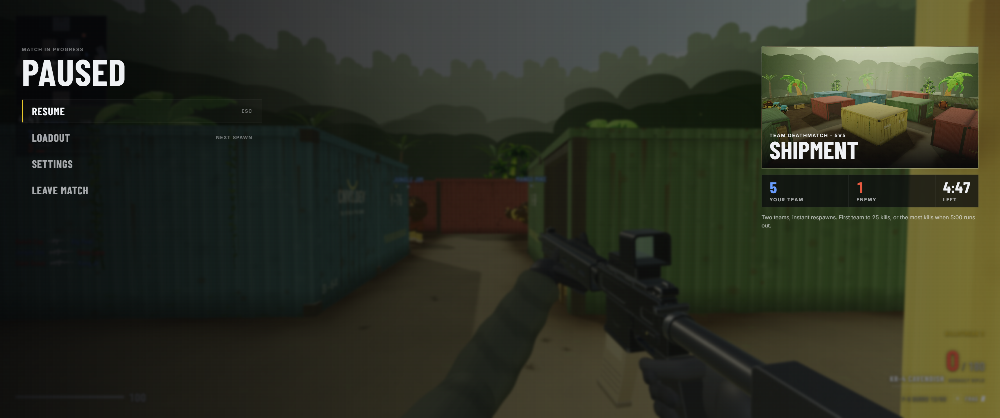
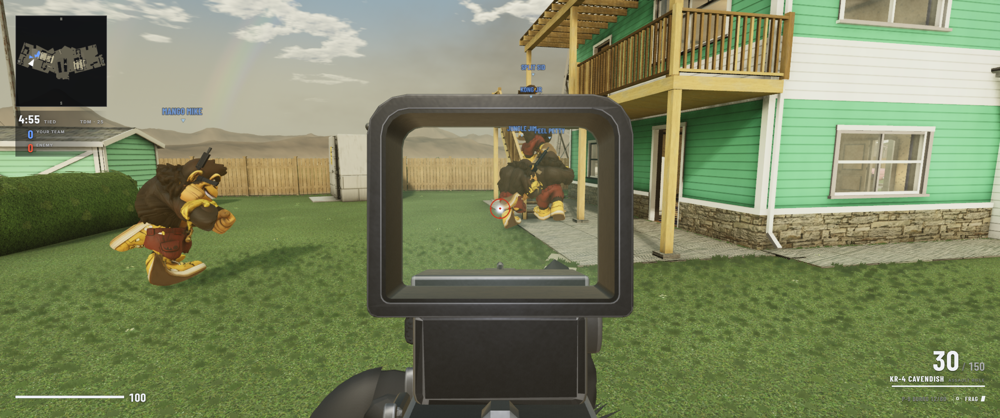
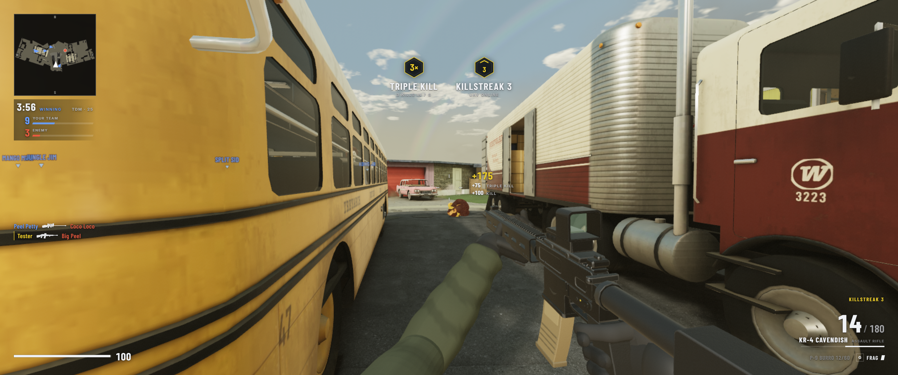

# BANANA SHIPMENT (ripoff)

Self-hostable version of the browser game at https://cnvs.dev/kong/ — playable offline (Quick Play vs bots) and online via **a custom multiplayer game server** (the original only ships the client; the server code is not published). The server in `server/` is a clean-room rebuild based on the official network protocol (`shared/protocol.ts`) and runs the same authoritative simulation (`shared/sim.ts`) as the client's offline Quick Play. It runs over LAN or behind a reverse proxy (see Playing / Own server with Docker).

**Important: always start the game via the HTTP server, never by double-clicking `index.html`.** Under `file://`, Chromium blocks all of the client's `fetch()` calls — menu 3D backgrounds go missing and Quick Play fails with "FAILED TO FETCH".

## Enhancements over the original

- **Better graphics (AAA pass):** post chain `RenderPass` → `ContactAO` → `Bloom` → `CINEMATIC` grade (tone map, vignette, chromatic aberration, film grain, color grade, sharpen, DOF-lite) → `FXAA`, with quality presets LOW–CINEMATIC plus individual switches in SETTINGS → GRAPHICS.
- **Controller / gamepad support:** standard Xbox/PlayStation mapping with sticks, rumble, and aim assist; layouts DEFAULT / TACTICAL / SOUTHPAW, sensitivity / deadzone / vibration options, button table, and menu navigation in SETTINGS → CONTROLS.
- **Many bug fixes**, e.g. around ADS, HUD, and gameplay details.
- **Lobby settings:** private-match lobby has a SETTINGS button (host, guests, spectators) that opens the settings modal over the lobby.
- **Nuketown balcony vault:** deck rail panels block like steel — Jump required to vault them, no automatic walk-over.
- **Endcard always fits (fullscreen fix):** the end-of-match screen shrink-fits its content to any viewport (shrink-only zoom, re-measured after webfont swap) with safe-centering and scroll fallback, so title, podium, both scoreboards, stats, accolades and PLAY AGAIN / MAIN MENU stay visible and reachable even in F11 fullscreen — the original can overflow and clip the buttons there.
- **Bot badge in scoreboards:** bots show a dedicated badge icon (`bot-badge.svg`) in its own column before the name in the HUD scoreboard (all modes incl. Gun Game) and the end-of-match board, and under the name on the podium, so humans and bots are instantly distinguishable in offline Quick Play and multiplayer; the flag is server-authoritative with subpath-safe asset resolution and hardened numeric parsing.
- **Audio autoplay fix:** no more "AudioContext was not allowed to start" warnings — audio unlocks on the first click/key/touch, so deep-links (`?play`) and menu hovers stay muted until then, after which the full mix (weapons, packs, ambience) fades in plus the match-start sting; pack loading is hardened with timeouts, size caps, and synth fallback.
- **Generated voice clips:** 49 doom-like announcer/Kong lines generated locally with audio.cpp/Qwen3-TTS in a deep Hartmann-style voice with warm mastering, played as audio files with `speechSynthesis` fallback when a clip is missing.
- **Restrained announcer direction:** anti-spam gating with cooldowns, priorities, and no repeats; killstreak announcements toggleable (default on); ascending killstreak callouts never repeat what was already heard; lead callout only once a team leads by 3; multikill callout in a fixed window instead of sliding; Kong and announcer never talk over each other.
- **Per-map menu music:** the main menu and the private lobby play a passive background loop per map (60–77 s each, period-aligned for clean looping — Shipment: industrial taikos; Dust2: desert-ops duduk; Ares Relay: cold synth pads; Nuketown: ironic surf twang with a dark turn), switching with a 1.5 s equal-power crossfade when the picked map changes. The bed sits at MASTER × MUSIC × 0.25 under everything, starts only after the first click/keypress (autoplay policy), goes quiet over live matches, and has its own slider in SETTINGS → AUDIO. Tracks live in `client/static/assets/audio/music/` (Opus primary, MP3 fallback); `docs/menu-music-prompts.md` holds the audio.cpp (`ace_step` / `stable_audio`) prompts + mastering chain to re-render them in AI quality as drop-in replacements.
- **Spray paint audio:** user-provided spray-can sound (Opus primary, M4A fallback), positional (local sprays play instantly, remote sprays with distance attenuation), synth fallback when clips are missing, balanced against similar one-shot effects.
- **Secure in-game text chat:** server-side badword filter with leet-folding, rate-limited, sender taken from the session (no spoofing, "server" name reserved), text-only rendering (no XSS); T key, Enter/Escape like in-game.
- **Team-colored clothing:** Kong on your own team wear blue shorts (enemies red), astronaut armbands/panels in team colors — all colorMode-aware (Protan/Deutan/Tritan), swapped per actor, FFA unchanged.
- **Reliable match end online:** the server retransmits the frozen end state until the rollover, duplicate-tick end signals replay idempotently (kills/feed stay deduplicated, nothing plays twice), a watchdog finishes the match when end evidence was seen but no snapshot arrives for seconds, stale end signals from the previous match can never re-raise the endcard over a live match, and the endcard dismisses itself once its countdown expires while the connection is confirmed live — so the end-of-match screen always appears, never hangs, and never pops back over the next match.
- **Per-mode public rooms:** PUBLIC MATCH follows the picked mode — separate always-on rooms per map for TDM, FFA, and Gun Game — so queuing public with an FFA or Gun Game selection actually lands in that mode instead of a pinned team mode.
- **Public gate sees the live match:** the codeless callsign check now answers with the running yard for the picked mode (exists/phase/mode flags) instead of blind defaults, so PUBLIC MATCH sees whether that mode's room is already live before joining.
- **Second player joins the live public match:** a second human lands in the same running yard room with an immediate seat — exactly one bot is evicted to make room while the first player keeps playing beside the newcomer.
- **Menu-music mute toggle:** one-click mute switch in the menu topbar next to the callsign chip, persisted in prefs and applied live on top of the SETTINGS → AUDIO slider.
- **Clean walls every match:** spray-paint decals are scrubbed at match end, on rematch, and on lobby/menu return, so tags never leak into the next match.
- **Menu discoverability:** SPRAY and CHAT key hints in the controls keyline, plus a "Source available on GitHub" link in the menu footer.
- **Lobby host tools:** the private-match lobby lets the host move players between teams, bench them, promote them back, and hand the host chair to another seat — guest writes are refused.
- **Host-leave transfer:** when the host leaves, the longest-seated member (bench included) becomes host automatically, picked by join time only — ping stays a display-only lobby badge and can never win the chair.
- **Private late-join:** invite-link players can join a running private match — a free seat plays immediately, a full room starts them on the bench with promotion on the next leave, and no bot is kicked to make room.

## Changelog

Own fixes are tracked in CHANGELOG.md (upstream ports excluded).

## Upstream sync log

Upstream features from the original (https://cnvs.dev/kong/) are ported in batches; own systems (graphics stack, gamepad, server, announcer direction, chat) stay untouched.

| Date | Upstream state | Included |
|---|---|---|
| 2026-10-20 | Upstream state as of 2026-10-20 (fresh rip) | Full client snapshot this version is based on |
| 2026-10-22/23 | Upstream state as of 2026-10-22/23 (fresh rip) | Base features: Gun Game, Penetration/Wallbangs, Xmas-Deko, Foot-Surfaces, Bug-Report, Gun-Preview, Lobby lobbyset/shuffle/relocate, Endcard-Podium, Colour Vision, Loadout-Wheel, Fence-Fix, Footstep-Verdrahtung |
| 2026-10-26 | Upstream state as of 2026-10-26 (fresh rip) | 11 updates: lobby follow + ping badges + kills-per-gun option; gun-game goal options (`GUN_KILL_OPTIONS` 1/2/3/5); announcer + Kong voice lines; combat-stats endcard; spraypaint emotes; anti-skate catch-up; Nuketown TDM limit 100; movement speeds; weapon rebalance |
| 2026-10-28 | Upstream state as of 2026-10-28 (fresh rip) | 9 updates: network-stats overlay; spawn facing toward map center; collateral multi-kills + medal; forklift/Ares steps fixes; directional damage indicator; crate penetration; voice-lines content table; special reload animations; spawn LOS weighting |

Last sync: 2026-10-28. Anything newer lives only in the original (https://cnvs.dev/kong/) until the next batch port.

## Quick start

```bat
npm run install:all   (one-time: installs client/ + server/ dependencies)
npm run build         (one-time: builds server/dist + client/dist)
npm run server        (hub on :8765 serving the self-built client — then open the URL below)
```

http://localhost:8765/ — pick the map in the menu (Shipment, Dust2, Ares Relay, Nuketown).
(Old `/kong/...` links keep working: the server 301-redirects them to root.)

## Screenshots

| ARES RELAY (ADS) | NUKETOWN (TDM triple kill) |
|---|---|
|  |  |
| NUKETOWN (ADS vs Jungle Jim) | SHIPMENT (pause menu, 5v5) |
|  |  |

## Scripts

| Command | What it does |
|---|---|
| `npm run dev` | Dev setup: Vite :5173 + game-server hub :8787 |
| `npm run play` | Server with SELF-BUILT client (`client/dist`, port 8765) |
| `npm run server` | Same as `play` |
| `npm start` | Same as `play` (npm convention) |
| `npm run test:protocol` | Headless protocol test (uses `server/dist`, spawns its own hub :8771) |

## Playing

The server provides the game files (web root `client/dist` — built from `client/src/` + `client/static/`), the multiplayer protocol (`ws://host:8765/ws` — the client appends the selected map itself), and `/healthz` for health checks. It binds to loopback by default; use `--host=0.0.0.0` only when you intentionally want direct LAN access.

The menu offers **QUICK PLAY** (offline vs bots), **PUBLIC MATCH** (multiplayer), and **PRIVATE MATCH** (code lobby, joinable via `?join=<CODE>` link). LAN access requires starting the server with `--host=0.0.0.0`. Seat counts follow the original modes (Shipment 5v5, other maps 6v6, FFA variants).

## Own server with Docker

Prerequisites: Docker + Compose plugin installed.

```sh
docker compose up -d --build        # hub on :8765 (KONG_PORT=... overrides the port)
docker compose logs -f              # watch logs
docker compose down                 # stop
```

The image is server-only: hub + map workers (container-internal `KONG_PORT+101..104`, no extra ports needed) serving `ws://host:8765/ws?map=<id>` and `/healthz` (also the Docker/Compose healthcheck). Compose binds the host port to `127.0.0.1` only; put it behind a reverse proxy for remote clients. It ships no client (static files answer 404) — host the client (`client/dist`) elsewhere and point it at the server WS URL.

## Directories

```
client/           Client package (own package.json: install/dev/build/preview)
client/src/       Client TypeScript source (Vite build)
client/static/    Raw game assets (models, textures, audio, maps — copied verbatim into dist by Vite)
client/vendor/    three.js r186 + used addons + TSL nodes (local, see VERSION.txt)
client/dist/      Built client (build artifact, git-ignored)
shared/           Original shared engine/protocol sources (client+server)
server/           Server package (own package.json: install/build/start/test)
server/src/      Clean-room game server (esbuild bundle in server/dist)
server/dist/      Server bundle (build artifact, git-ignored)
server/test-client.mjs   Headless protocol test
```

After cloning, run `npm run install:all && npm run build` (`client/dist/`, `server/dist/`, and `node_modules/` are git-ignored).

## Asset ownership

All game files (models, textures, audio, code) belong to the original author and must **not** be redistributed. This version is self-hostable (offline Quick Play and online multiplayer via the custom server, over LAN or behind a reverse proxy with Docker).
